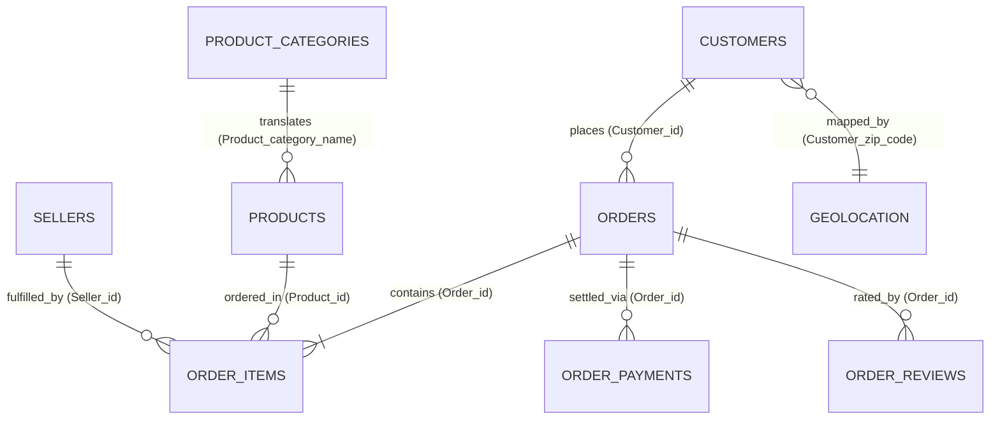

<div align="center">

# 📊 ShopNest Store — E-Commerce Business Intelligence & Analytics Dashboard
### **Comprehensive Power BI Capstone Project**

[](https://powerbi.microsoft.com/)
[](https://learn.microsoft.com/en-us/dax/)
[](https://powerbi.microsoft.com/)
[](#)

<p align="center">
  <b>An end-to-end Power BI analytics solution translating 9 relational e-commerce datasets into executive-level dashboards, operational intelligence, and actionable commercial insights for ShopNest Portugal.</b>
</p>

[Overview](#-business-overview) • [Datasets](#-dataset-architecture--data-dictionary) • [Data Modeling](#-data-modeling--star-schema) • [Key Analytical Tasks](#-analytical-questions--dashboard-features) • [DAX Calculations](#-key-dax-measures) • [Business Insights](#-business-insights--strategic-recommendations) • [Repository Structure](#-repository-structure) • [How to Run](#-getting-started)

---

</div>

## 📌 Business Overview

**ShopNest** is the leading marketplace department store in Portugal, serving as a unified bridge between small businesses across diverse Portuguese regions and commercial channels. By centralizing merchant storefronts and partnering with specialized logistics providers, ShopNest provides seamless direct-to-customer fulfillment.

### 🎯 Business Objective
To build an executive-grade, single-page dynamic Power BI dashboard backed by cross-report drillthrough capabilities to evaluate:
- **Revenue & Sales Drivers:** Identifying high-growth categories and regional revenue distribution.
- **Supply Chain & Delivery Logistics:** Monitoring shipping delays, SLA breaches, and on-time fulfillment rates across categories and time horizons.
- **Customer Experience & Satisfaction:** Analyzing customer ratings, feedback trends, and preferred payment mechanisms.
- **Seasonality & Forecasting:** Uncovering quarterly variations and yearly sales trajectories.

---

## 🗄️ Dataset Architecture & Data Dictionary

The project synthesizes **9 anonymized relational datasets** reflecting real-world e-commerce transaction lifecycles:

| # | Dataset Name | Primary Purpose / Description | Key Attributes |
|---|---|---|---|
| **1** | `Customers_dataset` | Customer identity and regional demographic data | `Customer_id`, `Customer_zip_code`, `Customer_city`, `Customer_state` |
| **2** | `Geolocation_dataset` | Geographic coordinate mapping for zip codes | `Geolocation_zip_code`, `Geolocation_lat`, `Geolocation_lng`, `Geolocation_city`, `Geolocation_state` |
| **3** | `Order_items_dataset` | Line-item transaction details and logistics limits | `Order_id`, `Order_item_id`, `Product_id`, `Seller_id`, `Shipping_limit_date`, `Price`, `Freight_value` |
| **4** | `Order_payments_dataset` | Multi-method transaction and installment data | `Order_id`, `Payment_sequential`, `Payment_type`, `Payment_installments`, `Payment_value` |
| **5** | `Order_reviews_dataset` | Customer feedback, score (1–5), and survey dates | `Review_id`, `Order_id`, `Review_score`, `Review_comment_title`, `Review_comment_message`, `Review_creation_date`, `Review_answer_timestamp` |
| **6** | `Orders_dataset` | Core order lifecycle, fulfillment timestamps & SLA status | `Order_id`, `Customer_id`, `Order_status`, `Order_purchase_timestamp`, `Order_approved_at`, `Order_delivered_carrier_date`, `Order_delivered_customer_date`, `Order_estimated_delivery_date` |
| **7** | `Products_dataset` | Product category taxonomy and physical dimensions | `Product_id`, `Product_category_name`, `Product_name_length`, `Product_description_length`, `Product_photos_qty`, `Product_weight_g`, `Product_length_cm`, `Product_height_cm`, `Product_width_cm` |
| **8** | `Sellers_dataset` | Merchant identifiers and geographic locations | `Seller_id`, `Seller_zip_code_prefix`, `Seller_city`, `Seller_state` |
| **9** | `Product_Categories` | Localization lookup (Portuguese to English translation) | `Product_category_name`, `Product_category_name_english` |

---

## 🧩 Data Modeling & Star Schema

The data model was structured into a high-performance **Star/Snowflake Schema** within Power BI Desktop:



### 🛠️ ETL & Data Transformation (Power Query)
- **Data Cleansing:** Replaced null values, stripped trailing whitespace, and formatted postal codes.
- **Datetime Normalization:** Parsed raw strings into standardized timestamps (`Purchase`, `Approval`, `Carrier Hand-off`, `Actual Delivery`, `Estimated Delivery`).
- **Calculated Flags:** Generated delivery SLA boolean (`Is Delayed = Delivered Date > Estimated Delivery Date`).
- **Category Localization:** Joined Portuguese category names to English translation reference tables for clean reporting.
- **Dedicated Calendar Date Table:** Created a centralized DAX Date Table supporting time intelligence calculations across Year, Quarter, Month, and Week.

---

## 📈 Analytical Questions & Dashboard Features

The dashboard addresses the **8 core analytical objectives** specified in the capstone requirements:

```
┌────────────────────────────────────────────────────────────────────────┐
│                   SHOPNEST EXECUTIVE DASHBOARD                         │
├─────────────────┬────────────────────┬────────────────┬────────────────┤
│ Total Revenue   │ Total Orders       │ On-Time Rate % │ Avg Rating ⭐   │
│ € XX.XX M       │ XX,XXX             │ XX.X%          │ X.XX / 5.0     │
├─────────────────┴────────────────────┴────────────────┴────────────────┤
│ [1] Top 10 Categories by Sales      │ [2] Delayed Orders by Category   │
│  - Bar Chart ranking top revenue    │  - Count of late deliveries per  │
│    generating product lines         │    category                      │
├─────────────────────────────────────┼──────────────────────────────────┤
│ [3] Monthly Delayed vs On-Time      │ [4] Payment Method Breakdown     │
│  - Clustered Column & Trend line    │  - Donut / Pie visual showing    │
│  - Drillthrough into Order SLA level│    Credit Card, Boleto, Vouchers │
├─────────────────────────────────────┼──────────────────────────────────┤
│ [5] Product Ratings (Top & Bottom)  │ [6] Regional & State Sales       │
│  - Dual Bar Charts: Top 10 highest  │  - Choropleth Map & State Rank   │
│    rated vs Bottom 10 lowest rated  │    identifying high/low markets  │
├─────────────────────────────────────┼──────────────────────────────────┤
│ [7] Seasonal Quarterly Patterns     │ [8] Yearly Revenue Trajectory    │
│  - Q1–Q4 seasonal trends across     │  - Multi-year revenue trajectory │
│    calendar years                   │    and annual growth rates       │
└─────────────────────────────────────┴──────────────────────────────────┘
```

### 1. 🏆 Top Categories by Total Sales
- **Visual:** Horizontal Clustered Bar Chart.
- **Functionality:** Identifies the top 10 revenue-generating product segments (e.g., Bed & Bath, Health & Beauty, Computers, Sports).
- **Insight:** Highlights where 80% of marketplace value is concentrated (Pareto principle).

### 2. ⏳ Delayed Orders Analysis by Category
- **Visual:** Ranked Column Chart / Sorted Bar Chart.
- **Criteria:** Flagged when `Order_delivered_customer_date` > `Order_estimated_delivery_date`.
- **Insight:** Pinpoints which product categories experience the highest delivery lag, exposing inventory and carrier fulfillment friction.

### 3. 📅 Monthly Comparison of Delayed vs. On-Time Orders
- **Visual:** Stacked / Clustered Column Chart with secondary line for % Delayed.
- **Cross-Report Drillthrough:** Enables stakeholders to right-click on any specific month to drill into an order-level details sheet containing carrier hand-off dates, customer cities, and delivery status.

### 4. 💳 Payment Method Distribution
- **Visual:** Donut Chart & Installment Frequency Matrix.
- **Metrics:** Share of transactions processed via Credit Card, Boleto, Debit Card, and Voucher, along with average installment counts.
- **Insight:** Unveils customer purchasing power and preferred credit facilities.

### 5. ⭐ Product Rating & Sentiment Analysis
- **Visual:** Side-by-Side Horizontal Bar Visuals.
- **Analysis:** Top 10 highest-rated products (minimum review volume threshold applied) vs. bottom 10 lowest-rated products (scores 1.0–2.5).
- **Insight:** Identifies catalog quality issues and product return risks.

### 6. 🗺️ State-Wise Regional Sales Performance
- **Visual:** Filled Map (Choropleth) combined with a ranked Pareto Bar Chart by state.
- **Analysis:** Identifies commercial powerhouse regions vs. emerging or under-penetrated Portuguese territories.

### 7. 🍂 Seasonal Sales Patterns (Quarterly Trends)
- **Visual:** Multi-Line / Area Chart segmented by `Q1`, `Q2`, `Q3`, and `Q4`.
- **Analysis:** Assesses cyclical demand spikes (e.g., holiday seasons, Black Friday, summer sale peaks) to optimize vendor inventory planning.

### 8. 📊 Yearly Revenue Growth & Trend Analysis
- **Visual:** Waterfall / Trend Line Chart with dynamic data labels.
- **Analysis:** Displays total gross merchandise value (GMV) change over time and YoY growth trajectory.

---

## 🧮 Key DAX Measures

Below are representative DAX measures created to power the KPIs and visuals:

```dax
// 1. Total Revenue
Total Revenue = 
SUM ( Order_items_dataset[Price] )

// 2. Total Freight Cost
Total Freight = 
SUM ( Order_items_dataset[Freight_value] )

// 3. Total Orders
Total Orders = 
DISTINCTCOUNT ( Orders_dataset[Order_id] )

// 4. Delayed Orders Count
Delayed Orders = 
CALCULATE (
    COUNTROWS ( Orders_dataset ),
    Orders_dataset[Order_delivered_customer_date] > Orders_dataset[Order_estimated_delivery_date],
    Orders_dataset[Order_status] = "delivered"
)

// 5. On-Time Orders Count
On-Time Orders = 
CALCULATE (
    COUNTROWS ( Orders_dataset ),
    Orders_dataset[Order_delivered_customer_date] <= Orders_dataset[Order_estimated_delivery_date],
    Orders_dataset[Order_status] = "delivered"
)

// 6. On-Time Delivery Percentage
On-Time Delivery % = 
DIVIDE ( [On-Time Orders], [Total Orders], 0 )

// 7. Delay Rate %
Delay Rate % = 
DIVIDE ( [Delayed Orders], [Total Orders], 0 )

// 8. Average Customer Review Score
Avg Review Score = 
AVERAGE ( Order_reviews_dataset[Review_score] )

// 9. Average Delivery Duration (Days)
Avg Delivery Days = 
AVERAGEX (
    FILTER ( Orders_dataset, NOT ISBLANK(Orders_dataset[Order_delivered_customer_date]) ),
    DATEDIFF ( Orders_dataset[Order_purchase_timestamp], Orders_dataset[Order_delivered_customer_date], DAY )
)

// 10. Year-over-Year Revenue Growth %
YoY Revenue Growth % = 
VAR PrevYearRevenue = 
    CALCULATE ( [Total Revenue], SAMEPERIODLASTYEAR ( 'DateTable'[Date] ) )
RETURN
    DIVIDE ( [Total Revenue] - PrevYearRevenue, PrevYearRevenue, 0 )
```

---

## 💡 Business Insights & Strategic Recommendations

1. **Logistics SLA Optimization:** 
   - Certain bulky or high-demand categories have a higher delay rate due to extended carrier handling times. Negotiate tighter dispatch SLAs with partner logistics providers.
2. **Payment Experience & Financing:**
   - Installment payments dominate high-ticket categories. Partnering with localized BNPL (Buy Now, Pay Later) solutions can further boost average order value (AOV).
3. **Quality & Catalog Audits:**
   - Products appearing in the bottom 10 ratings frequently show complaints regarding description mismatches or packaging damage. Restrict recurring low-rated merchant SKUs to protect brand trust.
4. **Targeted Regional Expansion:**
   - High sales concentration in major metropolitan states leaves vast opportunities in tier-2 regions. Implement localized shipping subsidies to capture rural market share.

---

## 📁 Repository Structure

```text
├── assets/
│   ├── screenshots/              # Screenshots of the Power BI dashboard & visual pages
│   └── architecture_diagram.png  # Data model diagram
├── data/
│   ├── Customers_dataset.csv
│   ├── Geolocation_dataset.csv
│   ├── Order_items_dataset.csv
│   ├── Order_payments_dataset.csv
│   ├── Order_reviews_dataset.csv
│   ├── Orders_dataset.csv
│   ├── Products_dataset.csv
│   ├── Sellers_dataset.csv
│   └── Product_Categories.csv
├── docs/
│   ├── ShopNest_Store_Capstone_Report.docx  # Detailed analytical report document
│   └── ShopNest Store Power BI Capstone.pdf # Capstone specification & rubric
├── ShopNest_Store_Analytics.pbix            # Complete Power BI dashboard workbook
├── LICENSE                                 # MIT License
└── README.md                               # Project documentation & GitHub showcase
```

---

## 🚀 Getting Started

### Prerequisites
- **Power BI Desktop** (Latest Version - November 2023 or newer recommended)
- **Microsoft Excel / Office** (To inspect CSVs or open the `.docx` project report)

### How to Run Locally
1. **Clone the Repository:**
   ```bash
   git clone https://github.com/your-username/shopnest-powerbi-capstone.git
   cd shopnest-powerbi-capstone
   ```
2. **Open the Dashboard:**
   - Double-click `ShopNest_Store_Analytics.pbix` to launch the dashboard in Power BI Desktop.
3. **Refresh Data Connections:**
   - In Power BI Desktop, navigate to `Home` > `Transform Data` > `Data source settings` to point the CSV file paths to your local `data/` directory if prompted.
   - Click `Refresh` to reload all visual calculations.
4. **Interact with the Report:**
   - Use dynamic slicers for date ranges, state selection, category filters, and test the cross-report drillthrough on monthly performance.

---

## 👤 Author & Acknowledgements

- **Developer:** [Kashif Akhter](https://github.com/kashifakhter7)
- **Program:** Business Analytics / Data Analytics Power BI Capstone Project
- **Special Thanks:** SkilloVilla & ShopNest Store E-Commerce Dataset Contributors

---

<div align="center">
  <sub>⭐️ If you find this project informative or helpful for your portfolio, please give it a star on GitHub!</sub>
</div>
